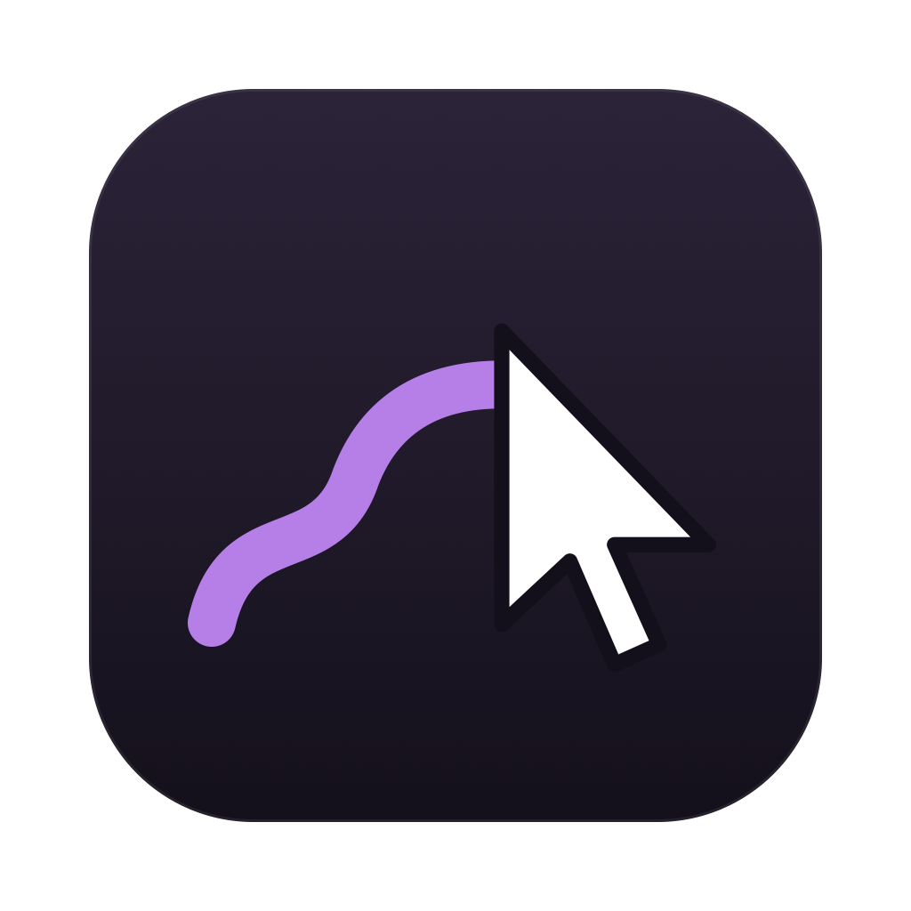

<p align="center">
  
</p>

<h1 align="center">Overpen</h1>

<p align="center">Draw over anything on your Mac screen. Built for tutorials, screen recordings, live demos and teaching.</p>

## Features

- One shortcut from any app to start drawing over the whole screen, on every display.
- Freehand lines, or frames with Shift + drag.
- Four colors you can change, and an adjustable line thickness.
- Undo, clear everything, stop with Esc.
- Every shortcut can be changed in Settings, and they follow your keyboard layout (QWERTY, AZERTY and others).
- Lives in the menu bar, no Dock icon, no account, no network access, sandboxed.
- English and French.

## Shortcuts

| Action | Default |
|---|---|
| Turn the pen on or off (works from any app) | ⌥⌘P |
| Undo last stroke | ⌘Z |
| Clear everything | C |
| Stop drawing | Esc |
| Colors 1 to 4 | 1, 2, 3, 4 |
| Draw a frame | Hold Shift while dragging |

## Install

Download it from the Mac App Store (coming soon), or build it yourself.

## Build

Requirements: macOS 14 or later and Xcode 16 or later.

```bash
git clone https://github.com/mariusdjen/overpen.git
cd overpen
scripts/build.sh
```

The script builds a Release version, installs it in `~/Applications` and launches it.
You can also open `Overpen.xcodeproj` in Xcode and press Run.

To sign with your own Apple account, create `Config/Local.xcconfig` (it is not versioned):

```
DEVELOPMENT_TEAM = YOURTEAMID
```

Without it, the app is signed to run on your Mac only.

## Project layout

| Path | Content |
|---|---|
| `Overpen/OverpenApp.swift` | App entry point |
| `Overpen/Overlay.swift` | Transparent drawing windows, strokes, undo, on screen hint |
| `Overpen/Shortcut.swift` | Actions, shortcuts, key names for the current keyboard layout |
| `Overpen/GlobalHotKey.swift` | The shortcut that works from any app |
| `Overpen/Preferences.swift` | Saved settings, open at login |
| `Overpen/StatusMenu.swift` | Menu bar icon and menu |
| `Overpen/SettingsWindow.swift`, `SettingsViews.swift` | Settings window and the shortcut recorder |
| `Overpen/Localizable.xcstrings` | Translations |
| `design/` | Icon sources (SVG) |

## Contributing

Issues and pull requests are welcome. Please keep the app small, fast and private: no tracking, no network.
To add a language, open `Overpen/Localizable.xcstrings` in Xcode and add it.

## License

MIT. See [LICENSE](LICENSE).

Made by [Marius Djenontin](https://github.com/mariusdjen), with Claude.
